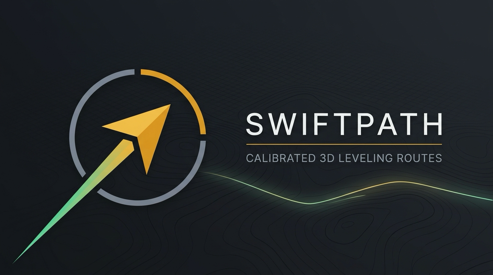

  

  <strong>Computed levelling routes for WoW: Forever.</strong> <em>(Alpha)</em>

  <a href="https://swiftpath.guide"><strong>Website</strong></a> ·
  <a href="https://www.curseforge.com/wow/addons/swiftpath"><strong>CurseForge</strong></a> ·
  <a href="https://addons.wago.io/addons/swiftpath"><strong>Wago</strong></a> ·
  <a href="https://discord.gg/WWAGSP7h5M"><strong>Discord</strong></a> ·
  <a href="https://github.com/Sefurio/swiftpath/issues"><strong>Issues</strong></a>

---

This repository is the public **issue tracker** for the Swiftpath addon. The addon itself is published on
CurseForge.

## What Swiftpath is

Swiftpath plans your levelling route by computing it. Routes are not hand-written: a model of the world, built
from real travel times, kill times and quest data, searches for the fastest order. Then the addon walks you
through it step by step, with its own waypoint arrow and a travel planner for flight paths, boats, zeppelins
and your hearthstone.

## What works today

Swiftpath is an alpha and only runs in **WoW: Forever**.

| Levels | Character |
|---|---|
| 1–12 | Every Horde race and class (23 combinations) |
| 12–20 | Tauren Druid |
| 20–30 | Tauren Druid |

More Horde level ranges are being built. Alliance routes are in preparation. A character without a route is
still measured, and that helps build its route.

## Reporting a bug

In the game, type `/swift report`. Swiftpath shows a short text with your addon version, route, step and
position. It contains no character name, realm or guild. If your version does not have `/swift report` yet,
write down your Swiftpath version, race, class, level, route and step instead. Then either

- post it in **#bug-reports** on [Discord](https://discord.gg/WWAGSP7h5M), or
- open a [bug report](https://github.com/Sefurio/swiftpath/issues/new?template=bug_report.yml) here.

Bugs are tracked here in public. Reports from Discord are copied to this tracker without your Discord name.

## Privacy

Nothing leaves your computer unless you agree. What the addon writes down and exactly what "Share data" sends
is listed on the [CurseForge page](https://www.curseforge.com/wow/addons/swiftpath).

## License

GPL-3.0. Quest data comes partly from QuestieDB and from [Polestar](https://github.com/fitzforge/polestar)
forever-db (GPL-3.0). The full list is in `THIRD_PARTY.md` inside the addon.
